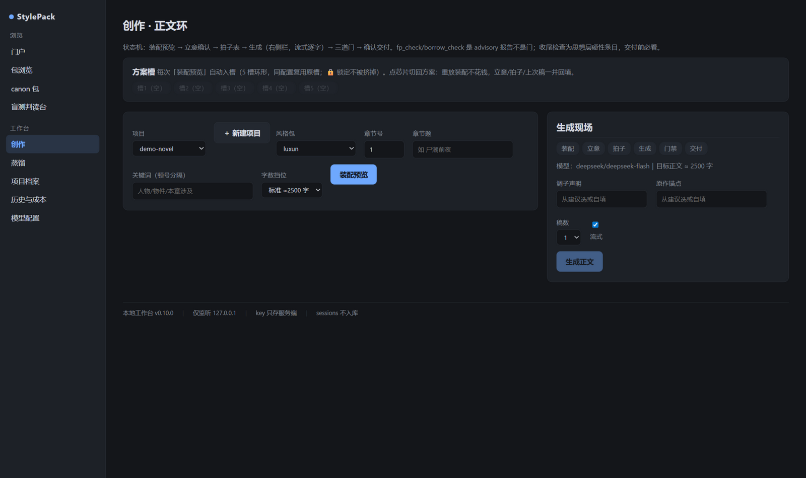
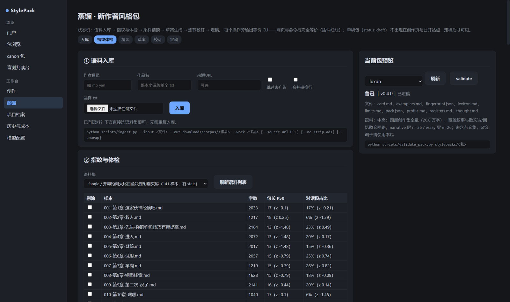

<div align="center">

# StylePack

**Open-source writing engine that gives any AI the style of a specific author.**

Quantified fingerprints · Self-contained style packs · Local workbench · Verifiable

[](https://github.com/Yunmoli1/stylepack/actions/workflows/ci.yml)
[](LICENSE)
[](https://www.python.org)
[](README.md)

[Quick start](#quick-start) · [中文文档](README.md)

</div>

---

StylePack distills an author into a **self-contained style pack**: quantitative
fingerprints + generative guidance + annotated exemplar quotes. Load on demand,
verify after every chapter — "does it feel like the author" becomes a
**measurable metric**.

```
ingest corpus → fingerprint checkup → close reading → human review → publish
   → assemble → streaming generation → 4 advisory gates → deliver & account
   → memory registration → feedback loop
```

## Local workbench

Full workflow without touching a terminal (Windows): double-click
`启动工作台.bat`, plug in your own API key, then distill new authors, write
chapters, and run blind tests. Listens on 127.0.0.1 only; keys never leave
your machine.

| Creation loop | Distillation |
|---|---|
|  |  |

What-you-see-is-what-gets-sent assembly preview → collaborative premise →
beat sheet → streaming generation → four gates (fingerprint / borrowed-lines /
AI-cliché / ending check) → revise-by-report / fragment rewrite → delivery
with automatic cost accounting. Six-step web distillation closes the loop for
"adding a new author"; blind-test win rate before publishing; draft packs
stay invisible to consumers until validated and published.

## Features

- **Verifiable** — sentence-length / dialogue-ratio / punctuation /
  reduplication metrics with tolerances + Burrows Delta author distance;
  borrowed-line check; AI-cliché detector; web blind-test win rates
- **Self-contained** — `export` a single-file pack, paste into any bare agent chat
- **Three front-ends, one engine** — local workbench · Agent Skills & MCP
  (12 skills + 10 memory tools) · CLI (every web button prints its CLI equivalent)
- **Long-form memory** — chapter digests / entity changes / foreshadowing with
  risk-graded quarantine merges; World-Info-style assembly (resident entries /
  recursive association / priority-trimmed budget)
- **Honest packs** — corpus provenance, sampling and confidence recorded;
  limits.md states which dimensions can't be imitated; per-chapter cost ledger
  includes real retry spend
- **Zero-dependency engine** — scripts/ and the MCP server use only the Python
  standard library (3.8+); web/ isolates fastapi/uvicorn/httpx/jinja2

## Quick start

**A. Local workbench (easiest)**

```bash
git clone https://github.com/Yunmoli1/stylepack.git
cd stylepack
# double-click 启动工作台.bat (auto-installs web deps, opens the browser)
# onboarding: API key → model → new project → first chapter
```

**B. Agent host (Claude Code / Codex-like)** — install the skills, follow
`style-setup`; see docs/adapters/.

**C. No host at all**

```bash
python scripts/export_pack.py stylepacks/luxun --out my.stylepack.md
# paste my.stylepack.md into any chat: "write a winter market scene in this style"
```

Public-domain sample packs included: **Lu Xun** (62 pieces, with tone registers)
and **Zhu Ziqing**. Full manual: [docs/usage.md](docs/usage.md) (Chinese).

## Principles

1. A plugin never changes the model — only the context it sees and the
   procedures it follows.
2. A pack is an operating manual, not a lab report — description
   (fingerprint) + generation (guidance) + demonstration (exemplars).
3. Models propose, scripts verify — verbatim quote checks, motif frequency
   validation, fingerprint comparison; generated claims are never trusted.
4. The repo ships no corpora — public-domain samples and short quotes only
   (≤200 chars); full texts never enter the repository.
5. Every paid action is previewed before it runs — costs are accounted
   per chapter, retries included.

## License

[Apache-2.0](LICENSE). See [CONTRIBUTING.md](CONTRIBUTING.md) for pack
submissions and the copyright discipline.

中文文档：[README.md](README.md)
