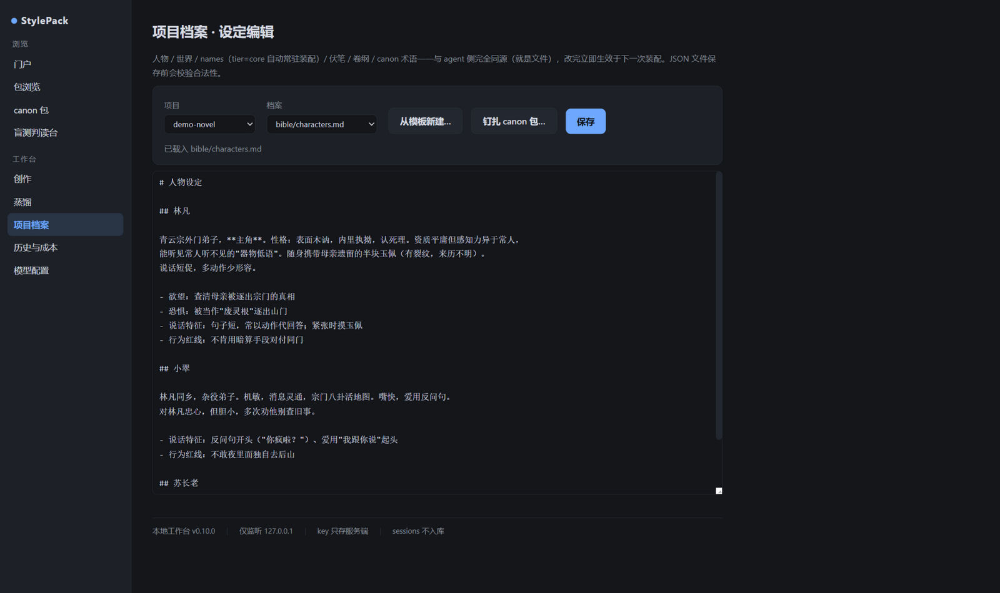

<div align="center">

# StylePack

**让任何 AI 获得"作者文风"能力的开源写作引擎**

量化指纹 · 自包含风格包 · 本地工作台 · 可验收

[](https://github.com/Yunmoli1/novels-of-style/actions/workflows/ci.yml)
[](LICENSE)
[](https://www.python.org)
[](#设计原则)

[快速开始](#快速开始) · [工作台一览](#本地工作台) · [设计原则](#设计原则) · [English](README.en.md)

</div>

---

把一位作者蒸馏成一个**自包含的风格包**：量化指纹 + 写作指导 + 短句范例。
写作时按需装载，写完自动验收——风格"像不像"从感觉变成**可测指标**。

```
语料入库 → 指纹体检 → 精读蒸馏 → 人工校订 → 定稿
    → 装配创作 → 流式生成 → 四道门验收 → 交付记账 → 记忆登记 → 反馈迭代
```

## 本地工作台

不写一行命令也能走完全程：双击 `启动工作台.bat`（Windows），配好自己的
API key，即可蒸馏新作者、写章节、跑盲测。仅监听 127.0.0.1，key 只存本机。

| 创作环 | 蒸馏台 |
|---|---|
|  |  |

装配预览**所见即所发** → 立意共创 → 拍子表 → 流式生成（右侧生成现场）
→ 四道门（指纹/借句/AI 腔/收尾）→ 按报告修订/局部改写 → 交付自动记账。

六步蒸馏"加一个新作者"全程网页闭环；定稿前网页盲测出胜率；草稿包
（status: draft）在定稿前对创作与站点不可见。

**项目档案**（人物/世界/canon/卷纲网页编辑，与 agent 侧同源文件协议）：



**记忆与成本**：交付自动登记章节摘要/状态变更/伏笔（隔离区按风险确认
合并），下一章装配自动带前情提要；历史页可视化每章真实成本。

## 特性

- **可验收**：句长分布/对话占比/标点指纹/叠词率带容差比对 + Burrows Delta
  作者距离；借句检查（≥12 字逐字重叠）；AI 腔检测（三档词表可扩充）；
  网页盲测胜率入账
- **自包含**：`export` 成单文件包，贴进任何裸 agent 对话即可用
- **三种使用姿势，一套引擎**：**本地工作台**（双击即用，见上）·
  **Agent Skills / MCP**（12 个技能 + 10 个记忆工具）· **CLI**
  （每个网页操作都有等价命令）
- **长篇记忆**：章节摘要/状态变更/伏笔的隔离区登记与风险分级合并；
  World Info 式装配（常驻条目/递归关联/优先级裁剪）
- **诚实档案**：语料来源/采样/置信度如实记录；limits.md 明说哪几维模仿不了；
  成本逐章记账（含重试的真实消耗）
- **零依赖引擎**：scripts/ 与 MCP server 仅用标准库（3.8+）；web/ 隔离
  fastapi/uvicorn/httpx/jinja2

## 快速开始

**姿势 A：本地工作台（最简单）**

```bash
git clone https://github.com/Yunmoli1/novels-of-style.git
cd novels-of-style
# 双击 启动工作台.bat（首次自动装 web 依赖并打开浏览器）
# 引导四步：配 key → 选模型 → 新建项目 → 写第一章
```

**姿势 B：有 agent 宿主（Claude Code / Codex 类）**

```bash
# 安装 skills 后走 style-setup 引导；各宿主路径见 docs/adapters/
```

**姿势 C：没有任何宿主**

```bash
python scripts/export_pack.py stylepacks/luxun --out my.stylepack.md
# 把 my.stylepack.md 贴进任意对话："按这个文风写一段冬天的集市"
```

自带公版示例包：**鲁迅**（62 篇语料，含调子分区）、**朱自清**。
完整说明见 [docs/usage.md](docs/usage.md)。

## 架构

```
┌──────────────────────────────────────────────────┐
│                    你的作品                        │
│   manuscript/ · sessions/ · slots/ · cost.jsonl   │
├──────────────┬───────────────┬───────────────────┤
│  Web 工作台   │  Agent Skills │   MCP 记忆层       │
│ （创作/蒸馏/  │ （12 技能：    │  （10 工具：状态机 │
│  档案/历史）  │  建档/写作/    │  /检索/人物卡/伏笔 │
│              │  验收/盲测）   │  /前情/成本）      │
├──────────────┴───────────────┴───────────────────┤
│        纯文件协议（workspace 与包目录）             │
├──────────────────────────────────────────────────┤
│ 零依赖引擎 scripts/：ingest · fp_extract · fp_check │
│ · build_delta · ai_cliche_check · borrow_check      │
│ · motif_count · validate/export · story · cost      │
├──────────────────────────────────────────────────┤
│ stylepacks/（作者包唯一家园：公版层 + local/）       │
│ canonpacks/（二创原作档案） · schemas/（版本化）     │
└──────────────────────────────────────────────────┘
```

三层共享同一套脚本与包文件——**网页做的每件事，命令行都能做**（每个
按钮旁就印着等价命令）。

## 设计原则

1. **插件不改模型，只改模型看到的上下文与遵循的流程**
2. **档案是操作手册不是体检报告**——描述层（指纹）+ 生成层（指导）+
   示范层（范例）缺一不可
3. **提案是模型的，校验是脚本的**——引文逐字校验、motif 频率验证、
   指纹比对，永不轻信生成结果
4. **仓库不自带语料**——只收录公版示例与短引（≤200 字），全文永不入库
5. **烧钱的操作先预告后执行**——成本逐章入账，含重试的真实消耗

## 路线（详见 [CHANGELOG](CHANGELOG.md)）

| 阶段 | 里程碑 |
|---|---|
| v0.2–0.4 | 分层指纹与真迹包络 · MCP 记忆 · 思想层 · 三仪交叉终审 |
| v0.5 | canon 层（二创档案）· 判读台 · 包统一管理 |
| v0.6 | 创作环闭环与硬化（空稿防御/字数挡位/流式/方案槽/防缩水） |
| v0.7–0.8 | 蒸馏台三阶段 + 网页盲测（真模型全流程验收） |
| v0.9 | 记忆接入 · AI 腔门 · World Info 装配 · 历史与成本 · UI 打磨 |
| **v0.10（当前）** | **完整工作台**：新建项目/引导/档案编辑器/章节管理 |

## 许可与贡献

[Apache-2.0](LICENSE)。欢迎 PR 风格包与类型包——见 [CONTRIBUTING.md](CONTRIBUTING.md)
（版权纪律：仓库永不收录受版权保护的全文；范例遵循短引 + 批注）。

English: [README.en.md](README.en.md)
